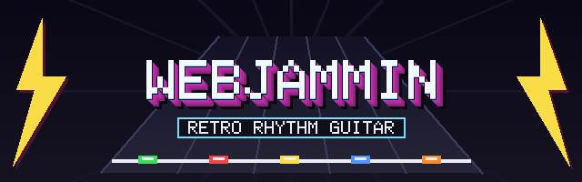
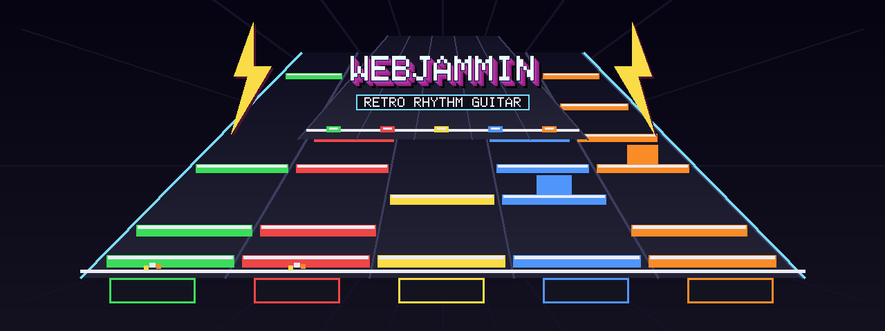
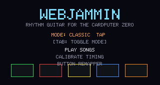
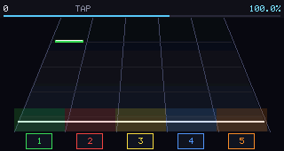
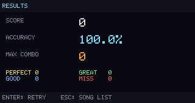
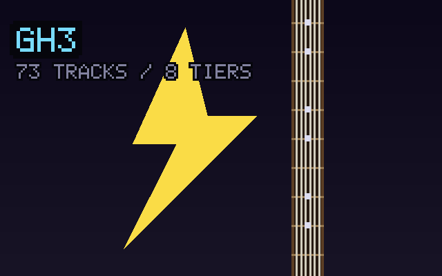
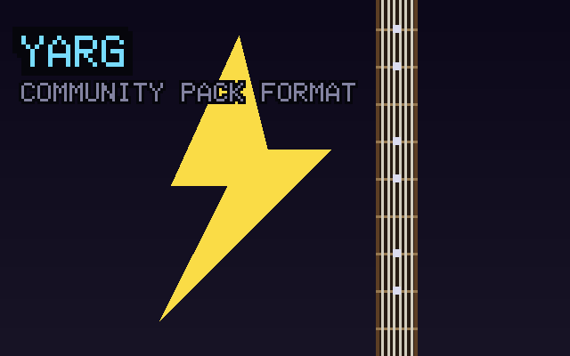
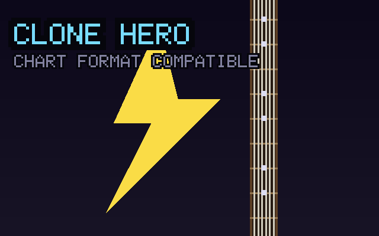

<p align="center">
  
</p>

<p align="center">
  <b>A keyboard-driven retro 3D pixel rhythm game for the M5Stack Cardputer Zero.</b><br>
  <i>Five frets under the panel. A 3D perspective trapezoid highway. Songs you stream from OGG or download from a catalogue.</i>
</p>

<p align="center">
  
</p>

<p align="center">
  <a href="https://github.com/NaustudentX18/webjammin/releases/tag/v0.1.0"></a>
  <a href="https://github.com/NaustudentX18/webjammin"></a>
  <a href="LICENSE"></a>
  <a href="#build"></a>
  <a href="#build"></a>
  
</p>

---

## Screens

| Title & Mode Select | Song Browser & Catalogue | 3D Perspective Gameplay | Results Screen |
|---|---|---|---|
|  |  |  |  |

All frames are real captures rendered from the game engine at 320 × 170.

```
   ┌────────────────────────────────────────────────────────┐
   │  12,340   [SHRED]         STAR POWER x4          97.2%  │  ← score / mode / multiplier / accuracy
   │  ████████████████████░░░░░░░░░░░░░░░░░░░░              │  ← star power / jam meter
   │             / ─── ─── ─── ─── ─── \                    │  ← 3D horizon (y=20, w=184px)
   │            /  ▓▓   │   │   │   │   \                   │
   │           /   │   ▓▓   │   │   │    \                  │  ← 3D perspective highway
   │          /    │    │  ▓▓   │   │     \                 │
   │         /     │    │   │  ▓▓   │      \                │
   │        /  ══════════════════════════   \  hit line     │  ← hit zone with particle flames
   │       [ 1 ]  [ 2 ]  [ 3 ]  [ 4 ]  [ 5 ]                │  ← 5-Cherry MX mod or keypad
   └────────────────────────────────────────────────────────┘
```

---

## Why this hardware

The Cardputer Zero's **`4 5 6 7 8` keys sit directly under its 1.9-inch
panel** — the vendor's layout guide encourages using them for primary actions.
WeBjammin turns the panel into an authentic arcade rhythm highway and supports both
the onboard keypad and a custom 5-Cherry MX mechanical switch mod attached to the
top 14-pin EXT header.

| | |
|---|---|
| **Display** | 320 × 170, RGB565, written with one direct `pwrite` of 108 800 bytes |
| **Audio** | 48 kHz through ES8389 (ALSA card 1) — the **playback position is the game clock** |
| **CPU / RAM** | 1 GHz quad-core Cortex-A53, 512 MB — game holds well under 48 MB RSS |
| **Input** | 46-key keypad · 5-Cherry MX mod (GPIO) · USB HID · Bluetooth HID, unified and hot-plugged |

---

## Features

| | |
|---|---|
| **3D Gameplay** | 3D perspective highway trapezoid, dynamic note scaling, HOPO jewels, multi-lane chords with fret anchoring, sustain tails, wide purple open note bars, animated hit flame sparks, and Star Power overdrive |
| **Dual Play Modes** | **Classic** (portable tap-to-hit for onboard keypad) & **Shredder** (authentic hold fret + strum for Cherry MX mod / guitar controllers). Toggle instantly with <kbd>TAB</kbd> in menus |
| **Judgement** | PERFECT ±25 ms, GREAT ±55 ms, GOOD ±90 ms, MISS beyond · score, combo, 1×–4× multiplier (up to 8× with Star Power), live accuracy, Rock/Jam meter, optional no-fail |
| **Input System** | One input manager over four backends: onboard keypad, **5-Cherry MX mod** on the 14-pin EXT header, **USB** HID guitars (Santroller, Guitar Hero, Rock Band), **Bluetooth** HID controllers — with hot-plug and an on-screen remapper |
| **Audio Engine** | Native **Ogg Vorbis (.ogg)** streaming via embedded single-file `stb_vorbis` (zero dynamic library dependencies), **WAV (.wav)** streaming, and an FM procedural synthesiser |
| **Charts** | Clone Hero **`.chart`** (full sync track, BPM changes, chords, HOPO, open notes, star power) · **`song.ini`** metadata parser · StepMania **`.sng`** · Standard MIDI **`.mid`** · native **`.wj.json`** |
| **Catalogue** | Point `catalogue.index_url` at a website, browse the songs in-game and **download them one at a time** — `.zip` archives unpacked automatically |
| **Extras** | Tap-test calibration that writes itself back to the config · per-song best scores in atomic JSON · offline screen renderer for screenshots |

<p align="center">
  
  
  
  
</p>

---

## Build

```sh
# Debian 13 (trixie) arm64 — the Cardputer Zero builds it itself
sudo apt install -y build-essential libasound2-dev curl unzip

git clone https://github.com/NaustudentX18/webjammin.git
cd webjammin
make
make test
./build/webjammin --generate-songs ~/webjammin/songs
./build/webjammin
```

Other targets:

```sh
make songs                                   # regenerate the bundled demo songs
./build/webjammin --selftest                 # diagnostics, devices, frame-loop test
./build/webjammin --render gameplay out.ppm  # render any screen offline
./build/webjammin --fetch-catalogue https://host/catalogue.json
./build/webjammin --download-catalogue https://host/catalogue.json 0 ~/webjammin/songs
python3 scripts/catalogue_server.py --charts songs --port 8000   # host a catalogue
```

---

## Controls

### Onboard Keypad

| Key | Action |
|---|---|
| `1` `2` `3` `4` `5` | Frets 1–5 (Green, Red, Yellow, Blue, Orange) |
| `SPACE` | Strum / open notes |
| `TAB` | **Toggle Play Mode** (Classic Tap vs Shredder Strum) / Pause |
| `F` `X` `Z` `C` | Up / down / left / right (vendor arrow keys) |
| `ENTER` | Confirm / start |
| `ESC` | Back / quit to song list |

### 5-Cherry MX Switch Hardware Mod (Top Header)

| Switch | EXT Header Pin | SoC BCM | Wire Color | Action |
|---|---|---|---|---|
| Fret 1 | Pin 5 | GPIO22 | Green | Green Fret (Lane 0) |
| Fret 2 | Pin 7 | GPIO11 | Red | Red Fret (Lane 1) |
| Fret 3 | Pin 9 | GPIO10 | Yellow | Yellow Fret (Lane 2) |
| Fret 4 | Pin 11 | GPIO9 | Blue | Blue Fret (Lane 3) |
| Fret 5 | Pin 13 | GPIO7 | Orange | Orange Fret (Lane 4) |
| Strum | Pin 12 | GPIO15 | White | Strum Switch |
| Ground | Pin 4 | GND | Black | Common Ground |

See **[HARDWARE_WIRING.md](HARDWARE_WIRING.md)** for complete 3D printable bracket specifications, switch recommendations (Speed Silver / Red / Kailh Choc), debouncing, and pull-up resistor advice.

### USB & Bluetooth Controllers

Auto-detected out of the box via Linux evdev:
- **Santroller / Guitar Hero / Rock Band**: Frets automatically bound (Green: A/1, Red: B/2, Yellow: Y/4, Blue: X/3, Orange: LB/5).
- **Strum Bar**: Bound to DPAD Up / DPAD Down.
- **Gamepads**: Face buttons + triggers supported with hot-plug.

---

## Configuration

```sh
mkdir -p ~/.config/webjammin
cp config/config.json ~/.config/webjammin/config.json
```

Timing windows, scroll speed, play mode (`"classic"` or `"shredder"`), audio device, GPIO pin map and controller profiles all live in that one file — a new guitar or button box needs **no recompile**. See [`HARDWARE_WIRING.md`](HARDWARE_WIRING.md) for the EXT header pinout and Bluetooth pairing, and [`CHART_FORMAT.md`](CHART_FORMAT.md) for chart formats.

---

## Why this stack

| Choice | Reason |
|---|---|
| **C++20** | Deterministic frame pacing, no GC pauses, low RSS, direct Linux input and framebuffer APIs |
| **No SDL2** | Not installed on the device, and a DRM backend would fight the APPLaunch launcher for `/dev/fb0` |
| **No libgpiod** | The kernel already exposes `/sys/class/gpio` — one less package, and remappable at runtime |
| **Direct ALSA** | The exact playback position (`snd_pcm_delay`) is what drives note timing; a game framework hides it |
| **5 × 7 bitmap font** | ~50 glyphs, no freetype, no font files — and the same table generates the site art |
| **Single-file stb_vorbis** | Fully embedded OGG streaming with zero external libraries or system dependencies |

---

## Testing

```bash
make test
```

**29 unit tests** cover:
- JSON roundtrip and validation
- Native `.wj.json`, Clone Hero `.chart` (with sync track, chords, HOPO, open notes, star power), MIDI `.mid`, and StepMania `.sng` parsers
- Deterministic procedural riff generator
- Judgement windows and scoring engine
- Dual play modes (`Classic` Tap and `Shredder` Strum)
- Active sustain holding and early release penalty
- Star power accumulation, activation, multiplier doubling, and duration decay
- Vorbis OGG streaming decoder
- Evdev hotplug, button and axis translation, controller profiles
- Atomic file writes and song library cache
- Catalogue client download flow
- Offline framebuffer screenshot rendering

```bash
./build/webjammin --selftest        # devices, songs, ten-frame loop test
./build/webjammin --render title out.ppm   # render any screen offline
scripts/bench.sh                     # frame time and RSS on the device
```

---

## Documentation

| | |
|---|---|
| [`README.md`](README.md) | this page |
| [`HARDWARE_WIRING.md`](HARDWARE_WIRING.md) | 5-Cherry MX switch mod, EXT header pinout, active-low wiring, Bluetooth and USB guitars |
| [`CHART_FORMAT.md`](CHART_FORMAT.md) | Clone Hero `.chart`, `.ogg`, `song.ini`, `.wj.json`, `.mid`, `.sng`, WAV and catalogue index |
| [`site/`](site/) | the full landing page — open `site/index.html` over any static server |
| [`docs/screens/`](docs/screens/) | every screen, rendered by the game itself |

---

## Licence & content

Original work, MIT licensed. **No copyrighted audio, charts or artwork is
included or redistributed.** The catalogue client fetches, on the user's
explicit request, from a catalogue the user points the game at — there is no
bulk scraper and no built-in source.

## Credits

Built for the **M5Stack Cardputer Zero** — a Raspberry Pi CM0 with a 320 × 170
panel, a 46-key TCA8418 keypad and an ES8389 codec.
