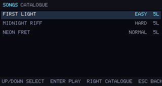
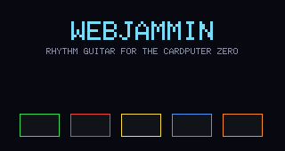
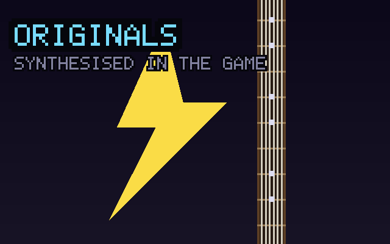

<p align="center">
  
</p>

<p align="center">
  <b>A keyboard-driven pixel rhythm game for the M5Stack Cardputer Zero.</b><br>
  <i>Five frets under the panel. A 320 × 170 highway. Songs you download from a catalogue.</i>
</p>

<p align="center">
  
</p>

<p align="center">
  <a href="https://github.com/NaustudentX18/webjammin/releases/tag/v0.1.0"></a>
  <a href="https://github.com/NaustudentX18/webjammin"></a>
  <a href="LICENSE"></a>
  <a href="#build"></a>
  <a href="#build"></a>
  
</p>

---

## Screens

| Title | Song browser | Gameplay | On the device |
|---|---|---|---|
|  |  |  |  |

The last frame is a real capture from `/dev/fb0` on the unit, not a mock-up.

---

## Why this hardware

The Cardputer Zero's **`4 5 6 7 8` keys sit directly under its 1.9-inch
panel** — the vendor's own layout guide tells app authors to put their five
primary action icons exactly there. That makes the panel a fret board and the
keypad a guitar neck, and it is why a phone-style rhythm game translates to this
device so cleanly.

| | |
|---|---|
| **Display** | 320 × 170, RGB565, written with one `pwrite` of 108 800 bytes |
| **Audio** | 48 kHz through the ES8389 (ALSA card 1) — the **playback position is the game clock** |
| **CPU / RAM** | 1 GHz quad-core Cortex-A53, 512 MB — the game holds well under 48 MB RSS |
| **Input** | 46-key keypad · GPIO buttons · USB HID · Bluetooth HID, unified and hot-plugged |

---

## Features

| | |
|---|---|
| **Gameplay** | 4- or 5-lane highway, sustain tails, HOPO notes, tap / hopo / strum rules, adjustable scroll speed, calibration offset |
| **Judgement** | PERFECT ±25 ms, GREAT ±55 ms, GOOD ±90 ms, MISS beyond · score, combo, 1×–4× multiplier, live accuracy, Rock/Jam meter, optional no-fail |
| **Input** | One input manager over four backends: onboard keypad, **GPIO** on the 14-pin EXT header, **USB** HID guitars, **Bluetooth** HID controllers — with hot-plug and an on-screen remapper |
| **Charts** | `.wj.json` (native) · Clone Hero `.chart` · Standard MIDI `.mid` · StepMania `.sng` · streamed WAV · a **procedural generator** so it plays with zero downloads |
| **Catalogue** | Point `catalogue.index_url` at a website, browse the songs in-game and **download them one at a time** — `.zip` archives unpacked automatically |
| **Extras** | Tap-test calibration that writes itself back to the config · per-song best scores in atomic JSON · an offline screen renderer for screenshots |

<p align="center">
  
  
  
  
</p>

---

## Build

```sh
# Debian 13 (trixie) arm64 — the Cardputer Zero builds it itself
sudo apt install -y build-essential libasound2-dev curl unzip

git clone https://github.com/NaustudentX18/webjammin.git
cd webjammin
make
make test
./build/webjammin --generate-songs ~/webjammin/songs
./build/webjammin
```

Other targets:

```sh
make songs                                   # regenerate the bundled songs
./build/webjammin --selftest                 # devices, songs, a frame-loop test
./build/webjammin --render gameplay out.ppm  # render any screen offline
./build/webjammin --fetch-catalogue https://host/catalogue.json
./build/webjammin --download-catalogue https://host/catalogue.json 0 ~/webjammin/songs
python3 scripts/catalogue_server.py --charts songs --port 8000   # host a catalogue
```

### Configure

```sh
mkdir -p ~/.config/webjammin
cp config/config.json ~/.config/webjammin/config.json
```

Timing windows, scroll speed, the audio device, the GPIO pin map and the
controller profiles all live in that one file — a new guitar or button box needs
**no recompile**. See [`HARDWARE_WIRING.md`](HARDWARE_WIRING.md) for the EXT
header pinout and Bluetooth pairing, and [`CHART_FORMAT.md`](CHART_FORMAT.md)
for the chart and catalogue formats.

---

## Why this stack

| Choice | Reason |
|---|---|
| **C++20** | Deterministic frame pacing, no GC pauses, low RSS, direct Linux input and framebuffer APIs |
| **No SDL2** | Not installed on the device, and a DRM backend would fight the APPLaunch launcher for `/dev/fb0` |
| **No libgpiod** | The kernel already exposes `/sys/class/gpio` — one less package, and remappable at runtime |
| **Direct ALSA** | The exact playback position (`snd_pcm_delay`) is what drives note timing; a game framework hides it |
| **5 × 7 bitmap font** | ~50 glyphs, no freetype, no font files — and the same table generates the site art |

---

## Roadmap

| Stage | What |
|---|---|
| **Shipped** | Core engine and play loop: four chart formats, audio-locked scheduler, judgement and scoring, four input backends, song browser, catalogue client, calibration, remapper — 22 unit tests green, verified on the device |
| **Next** | **Career & touring mode** — a venue ladder (eight tiers, three boss battles), setlists built from your catalogue, encore songs gated behind a full-combo clear, score-attack mode |
| **Planned** | **Versus, ghosts & the band** — hot-seat split highway, LAN races with one device as the timing authority, ghost replays, a local leaderboard, and bass/drum lanes with co-op parts |
| **Planned** | **Content & tooling** — a chart editor on the 46 keys, a seedable set generator, themes and note skins, and an APPLaunch store release |

---

## Documentation

| | |
|---|---|
| [`README.md`](README.md) | this page |
| [`HARDWARE_WIRING.md`](HARDWARE_WIRING.md) | EXT header pinout, active-low wiring, Bluetooth and USB guitars, the remapper |
| [`CHART_FORMAT.md`](CHART_FORMAT.md) | `.wj.json`, `.chart`, `.mid`, `.sng`, WAV and the catalogue index |
| [`site/`](site/) | the full landing page — open `site/index.html` over any static server |
| [`docs/screens/`](docs/screens/) | every screen, rendered by the game itself |

---

## Licence & content

Original work, MIT licensed. **No copyrighted audio, charts or artwork is
included or redistributed.** The catalogue client fetches, on the user's
explicit request, from a catalogue the user points the game at — there is no
bulk scraper and no built-in source. The Guitar Hero III track index in the
landing page is factual metadata (titles and artists) and links to no files.

## Credits

Built for the **M5Stack Cardputer Zero** — a Raspberry Pi CM0 with a 320 × 170
panel, a 46-key TCA8418 keypad and an ES8389 codec.
